# 개발 워크스테이션 환경 구축 미션

# 1. 프로젝트 개요
로컬 개발 환경의 재현성 확보, 내 컴퓨터에서만 돌아가는 문제를 방지하기 위해 터미널, Docker, Git/GitHub를 활용한 개발 워크스테이션 환경 구축

# 2. 실행 환경
- OS: Ubuntu 24.04.1 LTS (WSL2)
- Shell: bash
- Terminal: WSL2 Ubuntu
- Docker version: 29.9.2
- Git Version: 2.43.0
## 2.1 프로젝트 디렉토리 구조
프로젝트 루트(`~/codyssey_precorse`) 기준 디렉토리 트리 및 구성 요소별 역할입니다.
```
codyssey_precorse/
├── README.md               # 프로젝트 개요, 수행 로그 및 환경 구축 기술 문서
├── renamed.txt             # 권한 제어 실습용 파일 (chmod 600 적용)
├── test1.txt                # Git 버전 관리 및 변경 추적 검증 파일
├── test1_dir/              # 디렉토리 권한 제어 실습 폴더 (chmod 744 적용)
├── docs/                   # 증빙 스크린샷 보관 디렉토리
│   └── images/             # 터미널, 브라우저 포트 접속, Git 연동 캡처 이미지
└── web-server/             # 웹 서버 컨테이너화 작업 디렉토리
    ├── Dockerfile          # nginx:alpine 기반 커스텀 웹 서버 빌드 명세
    └── app/
        └── index.html      # 서빙 대상 정적 HTML 소스 파일 (바인드 마운트 연동)
```

# 3. 수행 항목 체크리스트
- [x] 터미널 기본 조작 및 작업 디렉토리 구성
- [x] 파일 및 디렉토리 권한 변경 실습 (chmod)
- [x] Docker 설치 및 데몬 구동 점검
- [x] Docker 기본 컨테이너(hello-world, ubuntu) 실행 실습
- [x] 커스텀 Dockerfile 작성 및 Nginx 기반 웹 서버 빌드/실행
- [x] 포트 매핑 및 브라우저 접속 검증
- [x] 바인드 마운트(-v)를 통한 호스트-컨테이너 간 변경 반영 검증
- [x] Docker 볼륨을 통한 데이터 영속성 검증
- [x] Git 사용자 설정 및 VS Code / GitHub 원격 저장소 연동

# 4. 수행 및 검증 로그
## 4.1 터미널 기본 조작 로그
현재 위치 확인, 디렉토리 생성 및 이동, 파일 생성, 내용 확인, 복사, 이름 변경, 숨김 파일 포함 목록 조회를 CLI 환경에서 수행
> 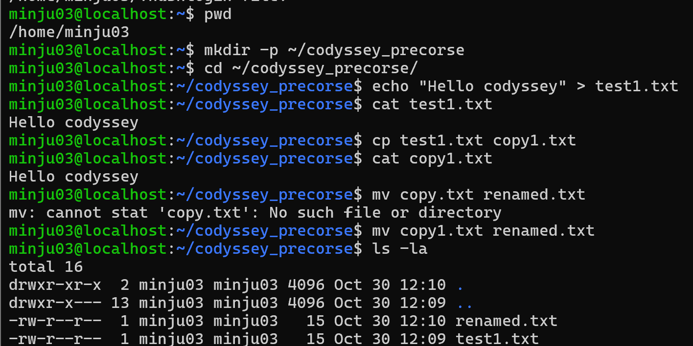
### 1) 현재 경로 확인

```
minju03@localhost:~$ pwd
/home/minju03
```

### 2) 디랙토리 생성 및 경로 이동
```
minju03@localhost:~$ mkdir -p ~/codyssey_precorse
minju03@localhost:~$ cd ~/codyssey_precorse/
```

### 3) 파일 생성 및 내용 확인

```
minju03@localhost:~/codyssey_precorse$ echo "Hello codyssey" > test1.txt
minju03@localhost:~/codyssey_precorse$ cat test1.txt
Hello codyssey
```

### 4) 파일 복사 및 복사본 확인
```
minju03@localhost:~/codyssey_precorse$ cp test1.txt copy1.txt
minju03@localhost:~/codyssey_precorse$ cat copy1.txt
Hello codyssey
```

### 5) 파일 이름 변경 및 목록 확인
```
minju03@localhost:~/codyssey_precorse$ mv copy1.txt renamed.txt
minju03@localhost:~/codyssey_precorse$ ls -la
total 16
drwxr-xr-x  2 minju03 minju03 4096 Oct 30 12:10 .
drwxr-x--- 13 minju03 minju03 4096 Oct 30 12:09 ..
-rw-r--r--  1 minju03 minju03   15 Oct 30 12:10 renamed.txt
-rw-r--r--  1 minju03 minju03   15 Oct 30 12:09 test1.txt
```

## 4.2 권한 실습
'chmod' 명령어를 사용하여 파일 1개와 디렉토리 1개의 접근 권한을 확인하고 설정하는 실습 수행
> 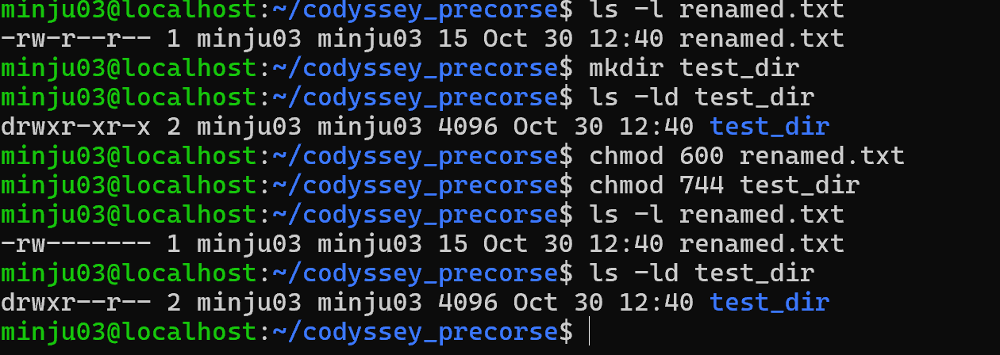

### 1) 파일과 디렉토리 기존 권한 확인
```
minju03@localhost:~/codyssey_precorse$ ls -l renamed.txt
-rw-r--r-- 1 minju03 minju03 15 Oct 30 12:40 renamed.txt
minju03@localhost:~/codyssey_precorse$ mkdir test1_dir
minju03@localhost:~/codyssey_precorse$ ls -ld test1_dir
drwxr-xr-x 2 minju03 minju03 4096 Oct 30 12:40 test1_dir
```

### 2) 파일과 디렉토리 권한 변경 적용
보안상 외부에 노출되면 안 되는 개인 설정 파일은 소유자만 읽고 쓸 수 있는 `600`으로 제한하고 디렉토리는 소유자의 탐색 권한(`x`)을 보장하면서 타인의 무단 수정을 막기 위해 `744`를 부여함.
```
minju03@localhost:~/codyssey_precorse$ chmod 600 renamed.txt
minju03@localhost:~/codyssey_precorse$ chmod 744 test1_dir
```

### 3) 변경된 권한 확인
```
minju03@localhost:~/codyssey_precorse$ ls -l renamed.txt
-rw------- 1 minju03 minju03 15 Oct 30 12:40 renamed.txt
minju03@localhost:~/codyssey_precorse$ ls -ld test1_dir
drwxr--r-- 2 minju03 minju03 4096 Oct 30 12:40 test1_dir
```

## 4.3 Docker 설치 및 기본 점검
Docker 엔진 버전 및 데몬 구동 상태, 시스템 정보를 점검
> 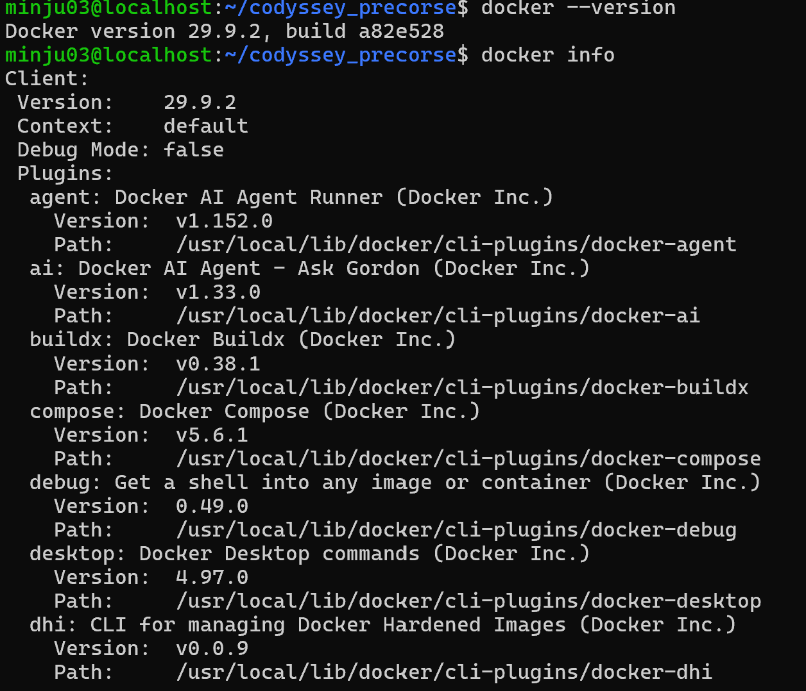
> 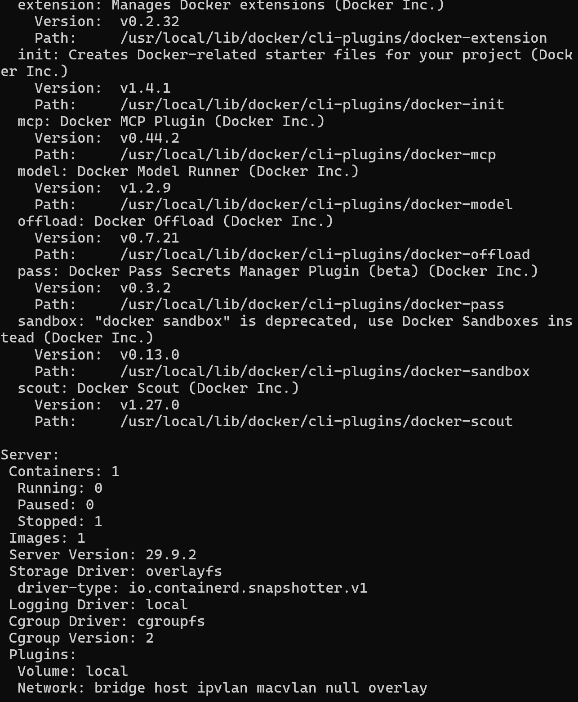
> 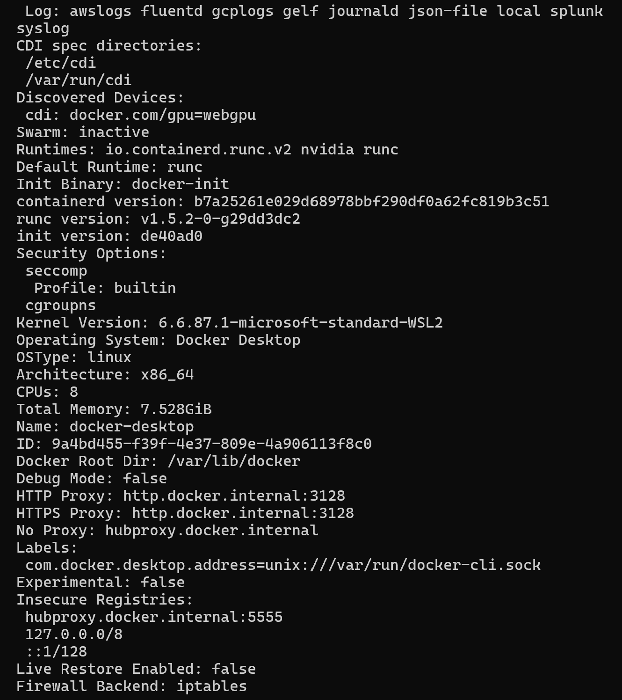
### 1) Docker 버전 확인
```
minju03@localhost:~/codyssey_precorse$ docker --version
Docker version 29.9.2, build a82e528
```

### 2) Docker 시스템 정보 확인
```
minju03@localhost:~/codyssey_precorse$ docker info
Client:
 Version:    29.9.2
 Context:    default
 Debug Mode: false
 Plugins:
  agent: Docker AI Agent Runner (Docker Inc.)
    Version:  v1.152.0
    Path:     /usr/local/lib/docker/cli-plugins/docker-agent
  ai: Docker AI Agent - Ask Gordon (Docker Inc.)
    Version:  v1.33.0
    Path:     /usr/local/lib/docker/cli-plugins/docker-ai
  buildx: Docker Buildx (Docker Inc.)
    Version:  v0.38.1
    Path:     /usr/local/lib/docker/cli-plugins/docker-buildx
  compose: Docker Compose (Docker Inc.)
    Version:  v5.6.1
    Path:     /usr/local/lib/docker/cli-plugins/docker-compose
  debug: Get a shell into any image or container (Docker Inc.)
    Version:  0.49.0
    Path:     /usr/local/lib/docker/cli-plugins/docker-debug
  desktop: Docker Desktop commands (Docker Inc.)
    Version:  4.97.0
    Path:     /usr/local/lib/docker/cli-plugins/docker-desktop
  dhi: CLI for managing Docker Hardened Images (Docker Inc.)
    Version:  v0.0.9
    Path:     /usr/local/lib/docker/cli-plugins/docker-dhi
  extension: Manages Docker extensions (Docker Inc.)
    Version:  v0.2.32
    Path:     /usr/local/lib/docker/cli-plugins/docker-extension
  init: Creates Docker-related starter files for your project (Docker Inc.)
    Version:  v1.4.1
    Path:     /usr/local/lib/docker/cli-plugins/docker-init
  mcp: Docker MCP Plugin (Docker Inc.)
    Version:  v0.44.2
    Path:     /usr/local/lib/docker/cli-plugins/docker-mcp
  model: Docker Model Runner (Docker Inc.)
    Version:  v1.2.9
    Path:     /usr/local/lib/docker/cli-plugins/docker-model
  offload: Docker Offload (Docker Inc.)
    Version:  v0.7.21
    Path:     /usr/local/lib/docker/cli-plugins/docker-offload
  pass: Docker Pass Secrets Manager Plugin (beta) (Docker Inc.)
    Version:  v0.3.2
    Path:     /usr/local/lib/docker/cli-plugins/docker-pass
  sandbox: "docker sandbox" is deprecated, use Docker Sandboxes instead (Docker Inc.)
    Version:  v0.13.0
    Path:     /usr/local/lib/docker/cli-plugins/docker-sandbox
  scout: Docker Scout (Docker Inc.)
    Version:  v1.27.0
    Path:     /usr/local/lib/docker/cli-plugins/docker-scout

Server:
 Containers: 0
  Running: 0
  Paused: 0
  Stopped: 0
 Images: 0
 Server Version: 29.9.2
 Storage Driver: overlayfs
  driver-type: io.containerd.snapshotter.v1
 Logging Driver: local
 Cgroup Driver: cgroupfs
 Cgroup Version: 2
 Plugins:
  Volume: local
  Network: bridge host ipvlan macvlan null overlay
  Log: awslogs fluentd gcplogs gelf journald json-file local splunk syslog
 CDI spec directories:
  /etc/cdi
  /var/run/cdi
 Discovered Devices:
  cdi: docker.com/gpu=webgpu
 Swarm: inactive
 Runtimes: io.containerd.runc.v2 nvidia runc
 Default Runtime: runc
 Init Binary: docker-init
 containerd version: b7a25261e029d68978bbf290df0a62fc819b3c51
 runc version: v1.5.2-0-g29dd3dc2
 init version: de40ad0
 Security Options:
  seccomp
   Profile: builtin
  cgroupns
 Kernel Version: 6.6.87.1-microsoft-standard-WSL2
 Operating System: Docker Desktop
 OSType: linux
 Architecture: x86_64
 CPUs: 8
 Total Memory: 7.528GiB
 Name: docker-desktop
 ID: 9a4bd455-f39f-4e37-809e-4a906113f8c0
 Docker Root Dir: /var/lib/docker
 Debug Mode: false
 HTTP Proxy: http.docker.internal:3128
 HTTPS Proxy: http.docker.internal:3128
 No Proxy: hubproxy.docker.internal
 Labels:
  com.docker.desktop.address=unix:///var/run/docker-cli.sock
 Experimental: false
 Insecure Registries:
  hubproxy.docker.internal:5555
  127.0.0.0/8
  ::1/128
 Live Restore Enabled: false
 Firewall Backend: iptables
```

### 3) Docker 데몬 프로세스 및 서비스 상태 점검
```
sudo service docker status
```

 ## 4.4 컨테이너 실행 및 기본 운영 실습
 > 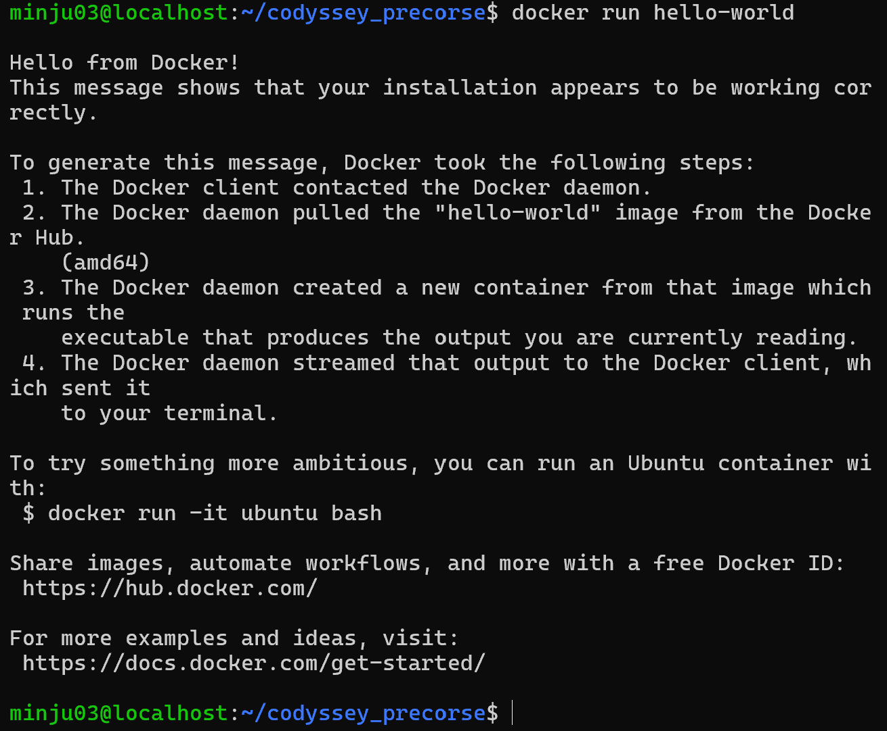
> 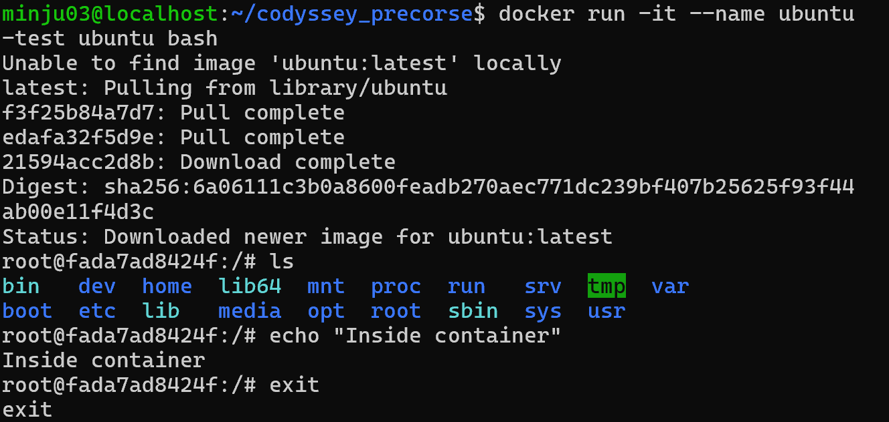
> 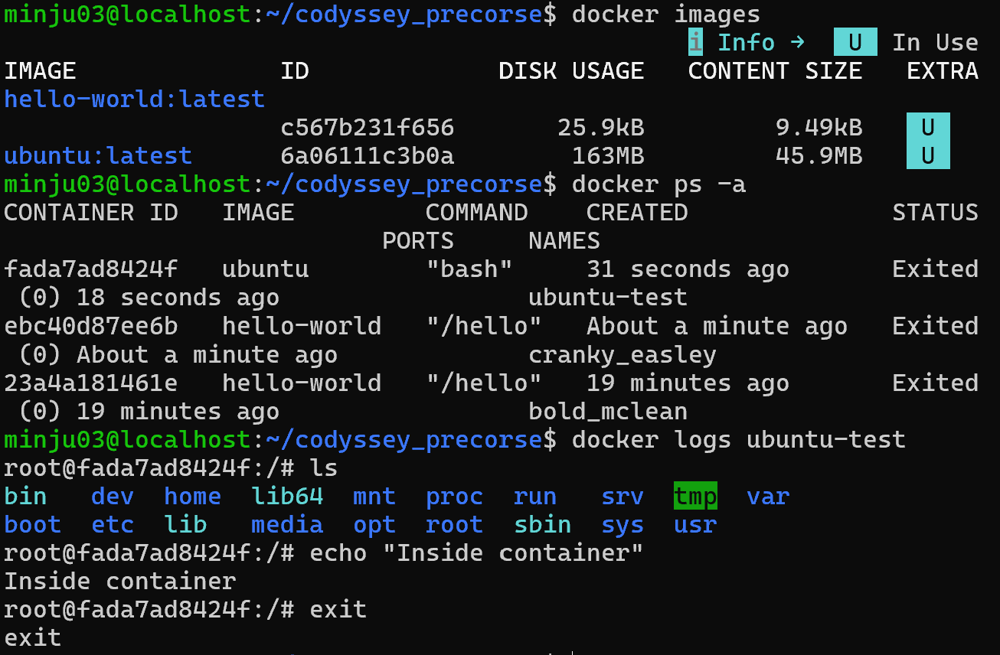
 ### 1) hello-world 컨테이너 실행
```
minju03@localhost:~$ docker run hello-world
Unable to find image 'hello-world:latest' locally
latest: Pulling from library/hello-world
4f55086f7dd0: Pull complete
d5e71e642bf5: Download complete
Digest: sha256:c567b231f65614688711a75f31518a064258a51d442117a3e771a3a8fdba78ef
Status: Downloaded newer image for hello-world:latest

Hello from Docker!
This message shows that your installation appears to be working correctly.

To generate this message, Docker took the following steps:
 1. The Docker client contacted the Docker daemon.
 2. The Docker daemon pulled the "hello-world" image from the Docker Hub.
    (amd64)
 3. The Docker daemon created a new container from that image which runs the
    executable that produces the output you are currently reading.
 4. The Docker daemon streamed that output to the Docker client, which sent it
    to your terminal.

To try something more ambitious, you can run an Ubuntu container with:
 $ docker run -it ubuntu bash

Share images, automate workflows, and more with a free Docker ID:
 https://hub.docker.com/

For more examples and ideas, visit:
 https://docs.docker.com/get-started/
```

### 2) Ubuntu 컨테이너 내부 진입 및 명령 수행
```
minju03@localhost:~/codyssey_precorse$ docker run -it --name ubuntu-test ubuntu bash
Unable to find image 'ubuntu:latest' locally
latest: Pulling from library/ubuntu
f3f25b84a7d7: Pull complete
edafa32f5d9e: Pull complete
21594acc2d8b: Download complete
Digest: sha256:6a06111c3b0a8600feadb270aec771dc239bf407b25625f93f44ab00e11f4d3c
Status: Downloaded newer image for ubuntu:latest

root@fada7ad8424f:/# ls
bin  dev  home  lib64  mnt  proc  run  srv  tmp  var
boot etc  lib   media  opt  root  sbin sys  usr
root@fada7ad8424f:/# echo "Inside container"
Inside container
root@fada7ad8424f:/# exit
exit
```


### 3) Docker 운영 검증 (이미지/컨테이너 목록/리소스 확인)
```
minju03@localhost:~/codyssey_precorse$ docker images
                                      ℹ Info ->    U   In Use
IMAGE               ID             DISK USAGE   CONTENT SIZE   EXTRA
hello-world:latest
                    c567b231f656   25.9kB       9.49kB         U
ubuntu:latest       6a06111c3b0a   163MB        45.9MB         U

minju03@localhost:~/codyssey_precorse$ docker ps -a
CONTAINER ID   IMAGE         COMMAND        CREATED              STATUS                          PORTS     NAMES
fada7ad8424f   ubuntu        "bash"         31 seconds ago       Exited (0) 18 seconds ago                 ubuntu-test
ebc40d87ee6b   hello-world   "/hello"       About a minute ago   Exited (0) About a minute ago             cranky_easley
23a4a181461e   hello-world   "/hello"       19 minutes ago       Exited (0) 19 minutes ago                 bold_mclean

minju03@localhost:~/codyssey_precorse$ docker logs ubuntu-test
root@fada7ad8424f:/# ls
bin  dev  home  lib64  mnt  proc  run  srv  tmp  var
boot etc  lib   media  opt  root  sbin sys  usr
root@fada7ad8424f:/# echo "Inside container"
Inside container
root@fada7ad8424f:/# exit
exit
```

## 4.5 Dockerfile 기반 커스텀 웹 서버 컨테이너 & 포트 매핑
> 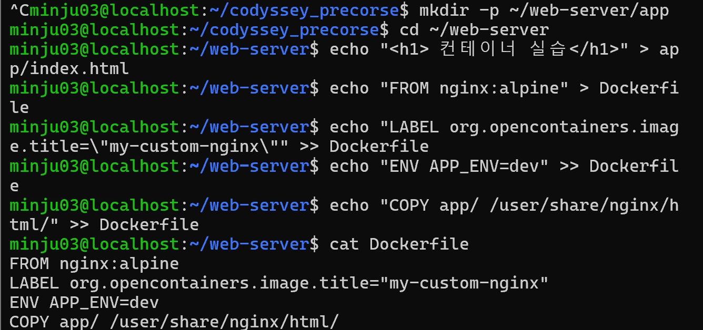
> 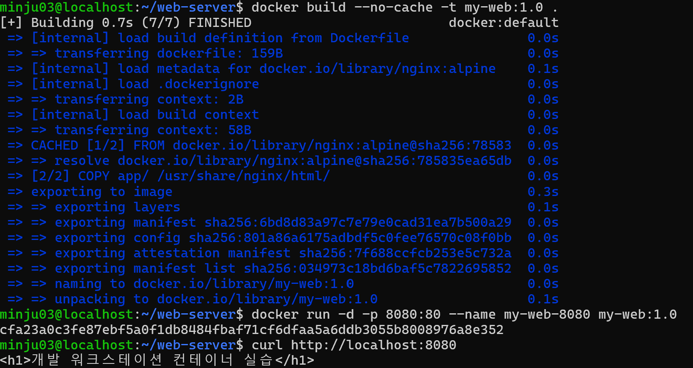
> 
- 컨테이너 구동 전 호스트 포트 충돌을 방지하기 위해 `ss -tulpn | grep 8080`으로 사전 점유 여부를 검사한 후 실행
### 1) 베이스 이미지 및 커스텀 설정
선택 베이스 이미지: nginx:alpine
선택 이유: 경량 OS 위에서 효율적으로 정적 웹 페이지를 서빙하기 위해 채택함.
커스텀 포인트:
- LABEL: 이미지 메타데이터 명시
- ENV: 환경 변수 주입
- COPY: 로컬 소스코드를 Nginx 웹 루트 경로로 복사 반영

### 2) Dockerfile 본문
```
FROM nginx:alpine
LABEL org.opencontainers.image.title="my-custom-nginx"
ENV APP_ENV=dev
COPY app/ /usr/share/nginx/html/
```

### 3) 웹 문서 작성 및 빌드
```
minju03@localhost:~/codyssey_precorse$ mkdir -p ~/web-server/app
minju03@localhost:~/codyssey_precorse$ cd ~/web-server
minju03@localhost:~/web-server$ echo "<h1>개발 워크스테이션 컨테이너 실습</h1>" > app/index.html
minju03@localhost:~/web-server$ echo "FROM nginx:alpine" > Dockerfile
minju03@localhost:~/web-server$ echo "LABEL org.opencontainers.image.title=\"my-custom-nginx\"" >> Dockerfile
minju03@localhost:~/web-server$ echo "ENV APP_ENV=dev" >> Dockerfile
minju03@localhost:~/web-server$ echo "COPY app/ /usr/share/nginx/html/" >> Dockerfile
minju03@localhost:~/web-server$ cat Dockerfile
FROM nginx:alpine
LABEL org.opencontainers.image.title="my-custom-nginx"
ENV APP_ENV=dev
COPY app/ /usr/share/nginx/html/

minju03@localhost:~/web-server$ docker build --no-cache -t my-web:1.0 .
[+] Building 0.7s (7/7) FINISHED                         docker:default
 => [internal] load build definition from Dockerfile               0.0s
 => => transferring dockerfile: 159B                               0.0s
 => [internal] load metadata for docker.io/library/nginx:alpine    0.1s
 => [internal] load .dockerignore                                  0.0s
 => => transferring context: 2B                                    0.0s
 => [internal] load build context                                  0.0s
 => => transferring context: 58B                                   0.0s
 => CACHED [1/2] FROM docker.io/library/nginx:alpine@sha256:78583  0.0s
 => => resolve docker.io/library/nginx:alpine@sha256:785835ea65db  0.0s
 => [2/2] COPY app/ /usr/share/nginx/html/                         0.0s
 => exporting to image                                             0.3s
 => => exporting layers                                            0.1s
 => => exporting manifest sha256:6bd8d83a97c7e79e0cad31ea7b500a29  0.0s
 => => exporting config sha256:801a86a6175adbdf5c0fee76570c08f0bb  0.0s
 => => exporting attestation manifest sha256:7f688ccfcb253e5c732a  0.0s
 => => exporting manifest list sha256:034973c18bd6baf5c7822695852  0.0s
 => => naming to docker.io/library/my-web:1.0                      0.0s
 => => unpacking to docker.io/library/my-web:1.0                   0.1s
minju03@localhost:~/web-server$ docker run -d -p 8080:80 --name my-web-8080 my-web:1.0
cfa23a0c3fe87ebf5a0f1db8484fbaf71cf6dfaa5a6ddb3055b8008976a8e352

minju03@localhost:~/web-server$ curl http://localhost:8080
<h1>개발 워크스테이션 컨테이너 실습</h1>
```


# 4.6 바인드 마운트(-v) 및 볼륨 영속성 검증
## 4.6.1 바인트 마운트 실습
> 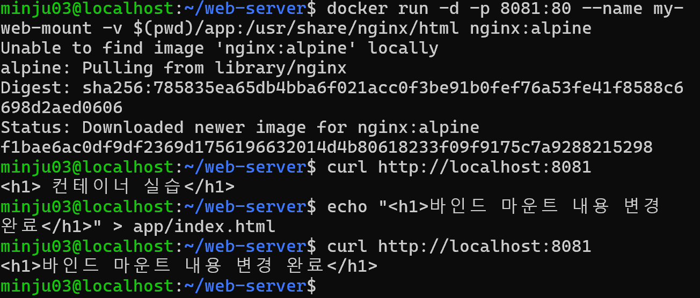
### 1) 바인드 마운트 옵션(-v)을 적용하여 컨테이너 백그라운드 실행 (호스트 포트 8081 매핑)
```
minju03@localhost:~/web-server$docker run -d -p 8081:80 --name my-web-mount -v$(pwd)/app:/usr/share/nginx/html nginx:alpine
Unable to find image 'nginx:alpine' locally
alpine: Pulling from library/nginx
Digest: sha256:785835ea65db4bba6f021acc0f3be91b0fef76a53fe41f8588c6698d2aed0606
Status: Downloaded newer image for nginx:alpine
f1bae6ac0df9df2369d1756196632014d4b80618233f09f9175c7a9288215298
```

### 2) 수정 전 curl 접속 확인
```
minju03@localhost:~/web-server$ curl http://localhost:8081
<h1> 컨 테 이 너 실 습</h1>
```

### 3) 호스트 파일(app/index.html) 내용 수정
```
minju03@localhost:~/web-server$ echo "<h1>바인드 마운트 내용 변경 완료</h1>" > app/index.html
```

### 4) 컨테이너 재시작 없이 즉시 변경 사항 반영 확인
```
minju03@localhost:~/web-server$ curl http://localhost:8081
<h1>바인드 마운트 내용 변경 완료</h1>
```

## 4.6.2 Docker 볼륨 영속성 실습
> 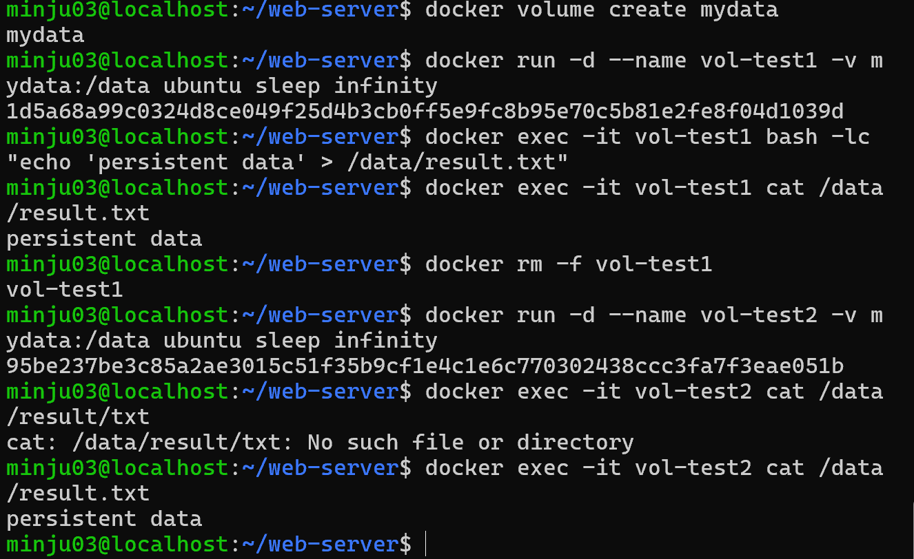
### 1) Docker 전용 볼륨 생성
```
minju03@localhost:~/web-server$ docker volume create mydata
mydata
```

### 2) 첫 번째 컨테이너에 볼륨 마운트(/data) 및 백그라운드 구동
```
minju03@localhost:~/web-server$ docker run -d --name vol-test1 -v mydata:/data ubuntu sleep infinity
1d5a68a99c0324d8ce049f25d4b3cb0ff5e9fc8b95e70c5b81e2fe8f04d1039d
```

### 3) 컨테이너 내부 볼륨 경로에 영속 데이터 기록 및 확인
```
minju03@localhost:~/web-server$ docker exec -it vol-test1 bash -lc "echo 'persistent data' > /data/result.txt"
minju03@localhost:~/web-server$ docker exec -it vol-test1 cat /data/result.txt
persistent data
```

### 4) 첫 번째 컨테이너 강제 삭제 (라이프사이클 종료)
```
minju03@localhost:~/web-server$ docker rm -f vol-test1
vol-test1
```

### 5) 동일한 볼륨(mydata)을 마운트하여 두 번째 컨테이너 구동
```
minju03@localhost:~/web-server$ docker run -d --name vol-test2 -v mydata:/data ubuntu sleep infinity
95be237be3c85a2ae3015c51f35b9cf1e4c1e6c770302438ccc3fa7f3eae051b
```

### 6) 이전 컨테이너에서 기록한 데이터 파일 보존 확인
```
minju03@localhost:~/web-server$ docker exec -it vol-test2 cat /data/result/txt
cat: /data/result/txt: No such file or directory
minju03@localhost:~/web-server$ docker exec -it vol-test2 cat /data/result.txt
persistent data
```

## 4.7 Git 설정 및 GitHub 연동
Git 전역 설정, 로컬 저장소 초기화, 첫 커밋 생성 및 원격 저장소 푸시

> 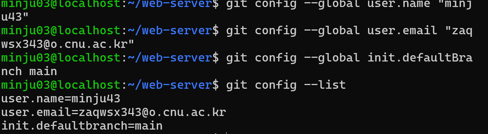
> 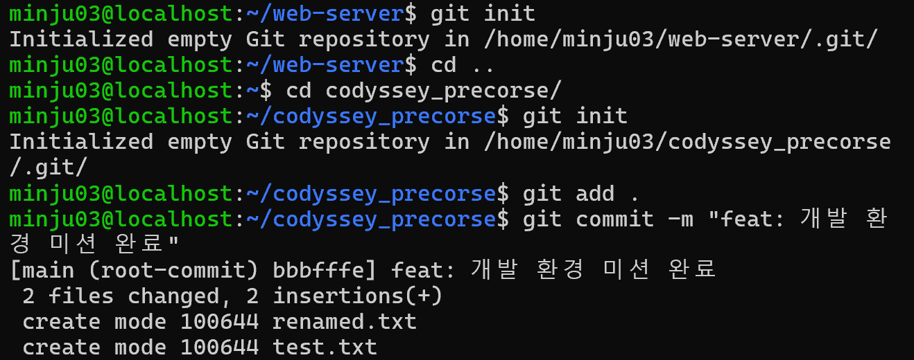
> 
> 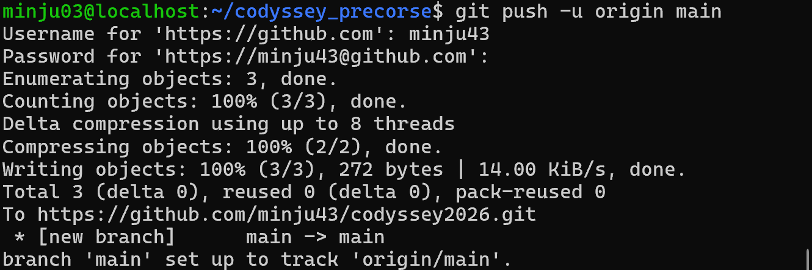
### 1) Git 전역 사용자 설정 및 확인
```
minju03@localhost:~/web-server$ git config --global user.name "minju43"
minju03@localhost:~/web-server$ git config --global user.email "zaqwsx343@o.cnu.ac.kr"
minju03@localhost:~/web-server$ git config --global init.defaultBranch main
minju03@localhost:~/web-server$ git config --list
user.name=minju43
user.email=zaqwsx343@o.cnu.ac.kr
init.defaultbranch=main
```

### 2) 실습 작업 디렉토리 이동 및 Git 저장소 초기화
```
minju03@localhost:~/web-server$ git init
Initialized empty Git repository in /home/minju03/web-server/.git/
minju03@localhost:~/web-server$ cd ..
minju03@localhost:~$ cd codyssey_precorse/
minju03@localhost:~/codyssey_precorse$ git init
Initialized empty Git repository in /home/minju03/codyssey_precorse/.git/
```

### 3) 실습 파일 스테이징 및 첫 커밋 생성
```
minju03@localhost:~/codyssey_precorse$ git add .
minju03@localhost:~/codyssey_precorse$ git commit -m "feat: 개발 환경 미션 완료"
[main (root-commit) bbbfffe] feat: 개발 환경 미션 완료
 2 files changed, 2 insertions(+)
 create mode 100644 renamed.txt
 create mode 100644 test.txt
```

### 4) Git 연결 및 main branch 푸시
```
minju03@localhost:~/codyssey_precorse$ git remote add origin https://github.com/minju43/codyssey2026.git
minju03@localhost:~/codyssey_precorse$ git branch -M main
minju03@localhost:~/codyssey_precorse$ git push -u origin main
Username for 'https://github.com': minju43
Password for 'https://minju43@github.com':
Enumerating objects: 3, done.
Counting objects: 100% (3/3), done.
Delta compression using up to 8 threads
Compressing objects: 100% (2/2), done.
Writing objects: 100% (3/3), 272 bytes | 14.00 KiB/s, done.
Total 3 (delta 0), reused 0 (delta 0), pack-reused 0
To https://github.com/minju43/codyssey2026.git
 * [new branch]      main -> main
branch 'main' set up to track 'origin/main'.
```

# 5. 트러블슈팅
### Issue 1) CLI 파일 이동/이름 변경 시 대상 파일 미인지 오류
- 문제: mv copy.txt renamed.txt 실행 시 cannot stat 'copy.txt': No such file or directory 에러 발생.
- 원인 가설: 직전 복사 명령에서 생성한 파일명이 copy.txt가 아닌 copy1.txt였을 것으로 추정.
- 확인: ls -la 명령어로 현재 작업 디렉토리의 파일 목록을 조회하여 실제 생성된 파일명이 copy1.txt임을 확인.
- 해결: 대상을 copy1.txt로 지정하여 mv copy1.txt renamed.txt 명령을 재수행해 완료.

### Issue 2) Dockerfile COPY 대상 경로 오타로 인한 Nginx 기본 페이지 노출
- 문제: Dockerfile 빌드 후 컨테이너를 구동하고 curl http://localhost:8080을 호출했으나 커스텀 HTML 대신 기본 "Welcome to nginx!" 페이지가 출력됨.
- 원인 가설: Dockerfile 작성 시 정적 파일 복사 대상 목적지 경로에 오타가 있어 파일이 기본 웹루트 디렉토리로 복사되지 못했을 것으로 판단.
- 확인: cat Dockerfile로 설정 내용을 확인한 결과 목적지 경로가 /usr/share/nginx/html/이 아닌 /user/share/nginx/html/로 오타가 입력되어 있음.
- 해결: 경로 오타를 수정한 뒤 기존 컨테이너를 삭제하고 docker build --no-cache -t my-web:1.0 . 명령어로 캐시 없이 재빌드하여 커스텀 문구가 정상 출력되도록 조치.
> 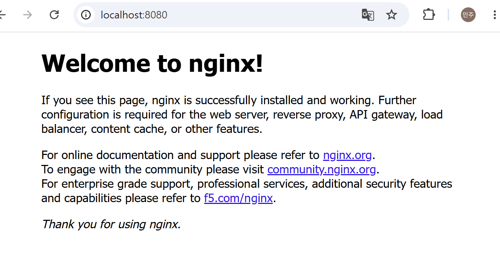

### Issue 3) 브라우저 접속 시 한글 문자 깨짐
- 문제: 'curl' 명령어로는 한글이 정상 출력되었으나, 브라우저 접속 시 한글이 깨짐.
- 원인 가설: HTML 파일 내에 UTF-8 인코딩 메타태그가 정의되지 않아 브라우저가 기본 문자셋으로 렌더링하면서 발생한 현상으로 판단.
- 확인: 터미널 curl 요청 결과 정상 바이트가 반환됨을 확인하여 네트워크 및 컨테이너 동작에는 이상이 없음을 확인.
- 해결: 네트워크 통신 및 포트 포워딩 동작 증빙에는 문제가 없음을 확인했으며, 웹 표준에 맞춰 HTML '<head>' 영역에 인코딩 메타태그를 주입하면 해결 가능함을 파악함.

### Issue 4) [운영 가이드] 포트 충돌 발생 시 진단 및 해제 절차
- 문제: 컨테이너 실행(`docker run -p 8080:80 ...`) 시 `Bind for 0.0.0.0:8080 failed: port is already allocated` 오류 발생
- 원인 가설: 호스트 시스템의 다른 백그라운드 프로세스나 기존에 종료되지 않은 Docker 컨테이너가 8080 포트를 이미 점유하고 있을 것으로 추정
- 확인:
  ```
  sudo lsof -i :8080 또는 ss -tulpn | grep 8080로 8080 포트를 점유 중인 프로세스 PID 확인
  docker ps -a --filter "publish=8080"로 8080 포트를 사용하는 기존 도커 컨테이너 점검
  ```
- 해결:
  1. 도커 컨테이너가 점유한 경우: docker rm -f <컨테이너ID>로 기존 컨테이너 삭제
  2. 일반 프로세스가 점유한 경우: sudo kill -9 <확인된PID>로 프로세스 종료
  3. 포트 해제 완료 후 컨테이너 재실행

# 6. 핵심 개념 정리
## 1. 절대경로와 상대경로 차이
- 절대경로: 최상위 루트 디렉토리 또는 사용자의 홈 디렉토리를 기준으로 파일이나 디렉토리의 고유한 위치를 나타냄. 현재 작업 위치에 영향을 받지 않고 고유한 경로를 유지함.
- 상대경로: 현재 작업 디렉토리를 기준으로 대상을 가리키며, 현재 디렉토리와 상위 디렉토리를 활용함. 작업 위치에 따라 가리키는 대상이 달라짐.

## 2. 파일 권한 및 8진수 표기 규칙
- 파일 및 디렉토리 권한은 소유자(user), 그룹(group), 기타 사용자(other) 세 영역으로 나뉘며, 각 영역은 읽기(r=4), 쓰기(w=2), 실행(x=1) 권한의 합인 8진수 숫자로 표현됨.
- 755(drwxr-xr-x): 소유자는 읽기, 쓰기, 실행이 모두 가능하며 그룹과 기타 사용자는 읽기, 실행만 가능함. 일반적인 실행 파일이나 디렉토리에 부여됨.
- 644(-rw-r--r--): 소유자는 읽기. 쓰기가 가능하고 그룹과 기타사용자는 읽기만 가능함. 일반 텍스트 문서나 소스코드 파일의 기본 권한임.

## 3. 기존 Dockerfile 기반 커스텀 이미지 제작 원리
: 이미 검증된 공식 베이스 이미지를 기반으로 하여 그 위에 필요한 정적 파일 복사, 환경 변수 주입, 메타데이터 정의와 같은 추가 레이어를 얹어 재사용 가능하고 격리된 독자적 컨테이너 이미지를 빌드함.

## 4. 포트 매핑의 필요성
: 컨테이너는 호스트 OS와 격리된 독자적인 가상 네트워크 네임스페이스와 내부 IP를 가짐. 따라서 호스트 컴퓨터나 외부 브라우저에서 컨테이너 내부 서비스에 접근하려면 호스트의 특정 포트와 컨테이터 내부 포트를 연결해 트래픽을 전달해 주는 포트 포워딩 터널링 설정이 필요함.

## 5. Docker 볼륨의 동작 원리
- 컨테이너 내부의 쓰기 가능한 레이어는 컨테이너 라이프사이클에 종속되어 있어 컨테이너가 삭제되면 저장된 데이터도 함께 영구 소멸하는 휘발성 특징을 가짐.
- Docker 볼륨은 컨테이너 수명 주기와 분리된 호스트 파일 시스템의 안전한 도커 관리 스토리지 영역을 사용하므로, 컨테이너를 강제 삭제하고 새로 생성해도 데이터가 영구 보존됨.

## 6. Git과 GitHub의 차이
- Git: 개발자의 로컬 컴퓨터에서 소스코드의 변경 이력을 추적하고 브랜치를 생성 및 병합하는 분산 버전 관리 도구.
- GitHub: Git으로 기록된 로컬 저장소를 클라우드에 올려 원격 백업하고, 코드 리뷰 및 이슈 추적 등 팀원 간의 협업을 지원하는 웹 기반 호스팅 플랫폼.
